# CodeShield AI: A Context-Aware and Destination-Sensitive Framework for Preventing Sensitive Data Leakage in Developer and LLM Workflows

**Review 1 Report | August 5, 2026**

**Student:** Bhargav Mahanta

**Registration Number:** [REGISTRATION NUMBER]

**Department:** [DEPARTMENT]

**Institution:** [INSTITUTION]

**Project Guide:** [GUIDE NAME]

## Abstract

Developers routinely handle credentials, personal information, proprietary source code, and internal configuration while using version control, application interfaces, and external large language model services. Accidental disclosure can occur through committed files, logs, API requests, copied prompts, retrieved documents, or generated responses. Conventional secret scanners primarily identify fixed patterns or high-entropy strings and can produce false positives while overlooking the context of a value, its intended destination, and the data-handling characteristics of the receiving service. CodeShield AI is a local-first framework that combines regular-expression and entropy detection with lightweight context classification, semantic sensitivity levels, destination-aware YAML policies, and explainable risk scoring. Based on the resulting decision, it can allow, warn, mask, pseudonymize, or block content. The framework scans only added staged Git lines, protects eligible personal data through reversible local pseudonymization, treats credentials and restricted source spans as non-transferable, and evaluates structured prompts against versioned LLM-provider profiles and local account attestations. The implemented prototype provides a Python 3.12 engine, Typer CLI, loopback-only FastAPI service, managed Git hook, local npm wrapper, generated TypeScript contracts, typed SDK, encrypted pseudonym vault, and metadata-only HMAC audit records. It has been validated with synthetic unit, integration, CLI, API, SDK, Git-hook, live loopback, and continuous-integration tests. CodeShield contributes a unified prevention layer that applies local, reviewable controls before sensitive developer artifacts cross Git or LLM trust boundaries.

**Keywords:** Sensitive Data Leakage; Secret Detection; Context-Aware Classification; Destination-Aware Policy; Prompt Sanitization; Large Language Model Security.

## 1. Problem Statement

Modern software development moves information through several trust boundaries. A value may begin in a local configuration file, become part of a staged Git diff, appear in an application log, or be pasted into an external LLM prompt. The same string has a different exposure consequence in each destination. A synthetic credential in a test fixture may deserve a warning, while a probable production key in a public repository or an external prompt must be blocked. Personal data may be useful to a task after local pseudonymization, whereas a private key must not be rewritten and forwarded.

Existing controls are commonly separated by channel: repository scanners inspect committed source, data-loss-prevention systems inspect organizational documents, and prompt filters inspect LLM requests. This separation makes it difficult to apply one explainable policy across developer files, staged changes, and structured LLM content. It can also encourage unsafe designs in which sensitive material is sent to a remote classifier before a decision is made.

CodeShield AI addresses this problem through a local preflight boundary. Detection, context assessment, policy evaluation, risk scoring, masking, and pseudonymization execute on the developer's machine. The current prototype does not call an LLM provider and does not claim to prove provider contracts. It records only masked findings in responses and metadata-only audit events locally.

## 2. Objectives

The objectives of the Review 1 prototype are to:

1. Detect common credentials, personal identifiers, financial values, and high-entropy unknown tokens without exposing complete values in output.
2. Distinguish probable real secrets from placeholders, test data, personal data, public information, and uncertain content using deterministic features and a lightweight classifier.
3. evaluate findings according to destination, repository visibility, sensitivity, provider profile, attestation status, and requested LLM features.
4. Produce explainable actions: allow, warn, mask, pseudonymize, or block.
5. Prevent unsafe staged Git additions through a real pre-commit hook and CI backstop.
6. Protect structured outbound prompts and assess inbound LLM responses before display, storage, or privileged-tool execution.
7. Keep raw values and reversible mappings local while retaining only minimal decision metadata.

## 3. Literature Review

### 3.1 Secret Leakage In Source Repositories

Secret leakage is a persistent software-engineering problem rather than an isolated configuration error. Meli, McNiece, and Reaves conducted a large-scale longitudinal analysis of public GitHub and found secret exposure across more than 100,000 repositories, with thousands of new unique secrets appearing daily [1]. Their study combined near-real-time commit monitoring with a large repository snapshot and demonstrated that hard-coded API keys and cryptographic key files were major causes of leakage. The work establishes both the scale of the problem and the need to intervene before a sensitive value becomes part of repository history. Its conservative focus on recognisable high-impact key formats, however, does not address broader personal or confidential data, test-versus-real context, or destination-dependent response.

Basak et al. later introduced SecretBench to support reproducible comparison of software-secret detectors [3]. The dataset contains 97,479 labelled candidates, including 15,084 true secrets, from 818 repositories spanning 49 programming languages and 311 file types. SecretBench demonstrates the diversity of source-code environments and the imbalance between true and false candidates. It also highlights an ethical challenge: useful detector benchmarks may themselves contain sensitive values and therefore require controlled access. CodeShield follows that lesson by using synthetic examples in its repository and treating broader benchmark evaluation as future work rather than presenting unit-test success as measured detector accuracy.

### 3.2 Detection, Context, And False Positives

Regular expressions and entropy are fast, deterministic candidate generators, but neither is sufficient in isolation. Saha et al. combined an extensive regular-expression set with contextual features and a voting classifier to distinguish real secrets from false positives [2]. Their results show that file type, surrounding text, token shape, and related features can reduce alert volume while preserving detection. The study is closely aligned with CodeShield's hybrid design, but its decision remains centred on whether a candidate is a secret; it does not model where the value is going or whether a transformation is acceptable for that destination.

Context has also been investigated in general data-loss prevention. Katz, Elovici, and Shapira proposed CoBAn, which builds contextual term graphs for confidential document clusters and detects small or rephrased confidential sections embedded in otherwise non-confidential documents [4]. CoBAn demonstrates that content and context should be evaluated together rather than reducing confidentiality to isolated keywords. Its organisational training model assumes curated confidential document collections and monitored communication channels. CodeShield instead uses local developer metadata, code context, repository visibility, segment provenance, and explicit destination policy, allowing it to operate without uploading a private training corpus.

Together, these studies support a layered detector in which precise patterns and entropy nominate candidates, contextual evidence reduces avoidable false positives, and a policy layer makes the final transfer decision. CodeShield additionally preserves detector source, confidence, masked preview, context label, policy rationale, and risk factors so that a reviewer can understand why an action was selected.

### 3.3 Privacy Risks In AI Coding Workflows

AI coding tools introduce a second leakage path: sensitive information may be submitted as model context or reproduced by a model. Niu et al. presented CodexLeaks, a semi-automated extraction pipeline that found sensitive personal information emitted by the Codex model used in GitHub Copilot [5]. Their human-in-the-loop evaluation reported privacy leakage for a subset of crafted prompts and framed the issue through contextual integrity. Huang et al. examined neural code-completion tools with the Hard-coded Credential Revealer and showed that commercial, open-source, and chat-oriented code models can reproduce memorised credentials from training data [6]. These works focus primarily on information emitted by models rather than accidental outbound disclosure by a developer, but they establish that both transfer directions deserve inspection.

CodeShield therefore represents content as structured `system`, `developer`, `user`, `retrieved`, `tool_output`, and `source_code` segments. Outbound material is classified before transfer, and inbound output can be scanned before display, storage, or execution. Private source defaults to Confidential; credentials, private keys, payment authentication data, active vulnerability details, health information, and other high-risk categories are promoted to Restricted and blocked from external LLMs in the current phase.

### 3.4 Local Prompt Protection

Client-side prompt sanitization is an emerging response to LLM privacy risk. Casper uses rule-based filtering, named-entity recognition, and a local browser model to identify personally identifiable information and sensitive topics before a prompt reaches a web-based LLM [7]. It replaces identifiers with placeholders and restores them in responses, showing that local interposition can protect privacy without modifying the provider. Casper concentrates on web prompts and user privacy; it does not unify Git workflow controls, repository sensitivity, provider-specific retention evidence, or destination-based source-code decisions.

Pr$\epsilon\epsilon$mpt formalises prompt sanitization and separates information whose utility depends on format from information whose utility depends on value [8]. It applies format-preserving encryption and metric differential privacy to protect sensitive tokens while attempting to preserve response quality. This provides stronger formal privacy motivation than ordinary redaction. CodeShield's current pseudonymization is deliberately narrower: it creates consistent encrypted local mappings for eligible personal data and blocks categories that cannot be safely transformed. Formal utility and privacy measurement remains future evaluation work.

Both studies support transforming prompts before provider exposure, but transformation must not be universal. Replacing a credential with a placeholder does not make it acceptable to transmit the surrounding unsafe source context. CodeShield separates semantic category from sensitivity and retains the original sensitivity and risk when an effective action changes after sanitization.

### 3.5 Prompt Injection, Trust Boundaries, And Governance

Retrieved documents and tool output create integrity risk as well as confidentiality risk. Yi et al. introduced BIPIA and found evaluated LLMs vulnerable to indirect prompt injection because models struggle to distinguish external data from actionable instructions [9]. Boundary awareness reduced attack effectiveness, but prompt wording alone cannot serve as an authorization mechanism. CodeShield marks retrieved and tool-produced content as untrusted, warns on deterministic injection indicators, and blocks the combination of untrusted injected content and privileged tools pending human approval.

The NIST AI Risk Management Framework organises risk work around Govern, Map, Measure, and Manage and stresses security, privacy, transparency, and documented accountability throughout the AI lifecycle [10]. NIST's Secure Software Development Framework similarly recommends integrating secure practices into the software development lifecycle rather than treating security as a final check [11]. OWASP's prompt-injection guidance recommends input/output filtering, least privilege, separation of external content, and human approval for high-risk operations [12]. These sources are governance and engineering baselines, not certifications. CodeShield maps their principles to local classification, explicit policy, metadata minimisation, trust-labelled segments, fail-closed transfer decisions, and CI enforcement.

### 3.6 Comparative Analysis And Research Gap

| Work | Problem | Method | Evaluation | Strength | Limitation | CodeShield contribution |
| --- | --- | --- | --- | --- | --- | --- |
| Meli et al. [1] | Public Git secret leakage | Pattern-based longitudinal mining | Millions of repositories and billions of files | Establishes scale and causes | Narrow secret formats and public Git focus | Prevents added staged leaks before commit |
| Saha et al. [2] | Scanner false positives | Regex candidates plus ML context | 5,000 labelled examples | Context reduces alert volume | No destination/provider model | Adds destination, policy, and explainable risk |
| SecretBench [3] | Lack of shared benchmark | Curated labelled repository dataset | 97,479 candidates across 818 repositories | Diverse evaluation baseline | Sensitive controlled dataset; no prevention workflow | Uses synthetic tests now; reserves benchmark metrics for evaluation |
| CoBAn [4] | Contextual document leakage | Confidential-term graphs | Reuters, plagiarism, and Enron-derived scenarios | Detects embedded/rephrased confidential text | Requires organisational training corpus | Uses local developer and transfer context without remote training |
| CodexLeaks/HCR [5], [6] | Leakage from code models | Extraction and memorisation tests | Commercial and open code-model studies | Establishes bidirectional model risk | Not a local developer transfer gate | Assesses outbound prompts and inbound responses |
| Casper [7] | PII in web LLM prompts | Local layered sanitization | 4,000 synthetic prompts | Client-side privacy protection | Browser and PII/sensitive-topic focus | Unifies prompts, source, Git, policy, and provider evidence |
| Pr$\epsilon\epsilon$mpt [8] | Privacy-preserving prompts | FPE and metric differential privacy | Utility/privacy experiments | Formal sanitization model | Does not cover Git or provider governance | Uses conservative transform-or-block policy and local restoration |
| BIPIA [9] | Indirect prompt injection | Benchmark and boundary-aware defenses | 25 LLMs, five scenarios | Demonstrates untrusted-content risk | Model-level defenses remain imperfect | Enforces provenance and privileged-tool blocking outside the model |

The literature addresses important parts of the problem: repository leakage measurement, false-positive reduction, contextual DLP, model memorisation, prompt sanitization, and indirect injection. The remaining gap is a single local developer framework that combines context classification, destination-sensitive policy, provider handling profiles and attestations, Git and prompt protection, reversible local pseudonymization, inbound assessment, and metadata-only auditing. CodeShield's research contribution is this integration and its explicit treatment of the transfer destination as part of the security decision.

## 4. Proposed And Implemented Architecture

### 4.1 Level 1: System Context And Trust Boundaries

The trusted local boundary contains the CodeShield CLI and engine, loopback FastAPI service, versioned policy configuration, provider profiles, local attestations, encrypted pseudonym mappings, and metadata-only audit storage. Developer files and staged additions enter only for local scanning. Git decisions flow to the commit operation and are repeated by CI as a backstop. Applications and the typed SDK submit structured segments to the loopback API; CodeShield returns a decision or locally protected content but makes no provider request in Phase 4. An application may send approved protected content to an external LLM, and the returned output is assessed before display, storage, or tool use.

The VS Code extension, transparent LLM proxy, dashboard, management API, and Supabase data plane are roadmap components and use dashed boundaries. They are not presented as implemented Review 1 functionality.

### 4.2 Level 2: Implemented Processing Architecture

The developer/Git path validates input constraints, skips binary or excluded files, scans only added staged lines when requested, runs regex and entropy detectors, resolves overlapping findings, classifies context, applies destination policy, calculates an explainable 0–100 risk score, and selects an action. A managed pre-commit hook converts block decisions into a failed commit; CI reconstructs changed additions as the enforcement backstop for native hook bypass.

The LLM path classifies structured segment categories, provenance, and highest sensitivity. It resolves a reviewed provider surface and exact local attestation, combines inherent and requested provider features, applies retention/training/feature policy, and either allows, warns, pseudonymizes eligible personal data, or blocks. Audit storage records only keyed payload/path correlation, profile version, sensitivity, categories, action, feature flags, counts, and timestamps for 30 days.

## 5. Implemented Prototype And Evidence

The Review 1 implementation is CodeShield Engine `0.4.0` at commit `cf48c5b`. Phase 4 is implemented on branch `phase-4-provider-policy`; PR #2 remains an open draft with green CodeShield CI and GitGuardian checks as reviewed on July 16, 2026.

Implemented components include:

- Python 3.12 security engine with regular-expression and entropy detectors, overlap resolution, context classification, YAML policy, risk scoring, and transformations.
- Typer CLI for file, directory, staged Git, policy, provider, prompt, hook, evaluation, and local-server operations.
- Loopback-only FastAPI endpoints for health, version, scanning, protection, restoration, LLM assessment, and LLM protection.
- Managed native Git hook and changed-additions CI enforcement.
- AES-GCM encrypted local pseudonym vault and metadata-only HMAC-correlated LLM audit database.
- Twenty versioned provider-surface profiles and expiring local administrative attestations.
- Private npm workspaces containing a Python process wrapper, committed OpenAPI contract, generated shared types, and typed SDK.

Current automated evidence comprises 84 collected Python tests and 9 TypeScript Vitest tests. The test suite covers detectors, classification, policy, risk, transformations, vault encryption, files, CLI behavior, Git diffs and hooks, APIs, provider profiles, LLM preflight, SDK safety, generated contracts, and secret-free fixtures. A live loopback smoke test verifies masked scanning, Restricted LLM blocking, pseudonymization, and restoration. These are implementation tests, not benchmark precision, recall, or F1 measurements.

## 6. Security Properties And Limitations

The prototype uses loopback binding, request-size limits, restricted CORS, argument-array subprocess execution, generic errors, masked findings, fail-closed provider decisions, local-only reversible mappings, and metadata minimisation. Restricted content cannot be excepted for external LLM transfer. Provider profiles are reviewed evidence, while attestations are administrative records; neither mechanism proves contractual compliance.

Current limitations are material to interpreting the work:

- Detection relies on regex, entropy, deterministic semantic rules, and a small synthetic context-classifier baseline; false positives and false negatives remain possible.
- Presidio, spaCy, and Gitleaks/detect-secrets adapters are not yet integrated.
- Benchmark precision, recall, F1, leakage-prevention rate, and latency distributions have not yet been measured on a licensed evaluation corpus.
- Native `git commit --no-verify` cannot be prevented locally; CI is the backstop.
- The npm packages are private workspaces, and provider account configuration is attested manually.
- The VS Code extension, transparent proxy, hosted services, dashboard, and Supabase integration are future work.

## 7. Roadmap And Expected Outcomes

After Review 1, the project will prioritise detector expansion and a reproducible synthetic/licensed evaluation pipeline before adding user-interface breadth. Planned work includes Presidio/spaCy and secret-scanner adapters, a debounced VS Code extension, a mock-upstream LLM proxy, a reusable logging sanitizer, and a metadata-only hosted management plane with role-controlled policies. The expected outcome is a measurable developer security framework that reduces accidental exposure at the point of action while retaining transparent local control.

## 8. Conclusion

CodeShield AI treats sensitive-data leakage as a context and transfer problem, not only a pattern-matching problem. The Review 1 prototype demonstrates a local, explainable path from finding detection through context, destination, provider evidence, policy, risk, and protective action. Its principal contribution is the integration of Git protection and provider-aware LLM preflight under one conservative local policy boundary. The current implementation provides evidence of technical feasibility; the next research task is rigorous detector and workflow evaluation without compromising real secrets or personal data.

## References

[1] M. Meli, M. R. McNiece, and B. Reaves, “How Bad Can It Git? Characterizing Secret Leakage in Public GitHub Repositories,” in *Proc. Network and Distributed System Security Symposium (NDSS)*, 2019, doi: 10.14722/ndss.2019.23418.

[2] A. Saha, T. Denning, V. Srikumar, and S. K. Kasera, “Secrets in Source Code: Reducing False Positives Using Machine Learning,” in *Proc. 12th International Conference on Communication Systems & Networks (COMSNETS)*, 2020, pp. 168–177.

[3] S. K. Basak, L. Neil, B. Reaves, and L. Williams, “SecretBench: A Dataset of Software Secrets,” in *Proc. 20th International Conference on Mining Software Repositories (MSR), Data and Showcase Track*, 2023.

[4] G. Katz, Y. Elovici, and B. Shapira, “CoBAn: A Context Based Model for Data Leakage Prevention,” *Information Sciences*, vol. 262, pp. 137–158, 2014, doi: 10.1016/j.ins.2013.10.005.

[5] L. Niu, S. Mirza, Z. Maradni, and C. Pöpper, “CodexLeaks: Privacy Leaks from Code Generation Language Models in GitHub Copilot,” in *Proc. 32nd USENIX Security Symposium*, 2023, pp. 2133–2150.

[6] Y. Huang, Y. Li, W. Wu, J. Zhang, and M. R. Lyu, “Your Code Secret Belongs to Me: Neural Code Completion Tools Can Memorize Hard-Coded Credentials,” *Proceedings of the ACM on Software Engineering*, 2024, doi: 10.1145/3660818.

[7] C. J. Chong, C. Hou, Z. Yao, and S. M. S. Talebi, “Casper: Prompt Sanitization for Protecting User Privacy in Web-Based Large Language Models,” arXiv:2408.07004, 2024.

[8] A. R. Chowdhury, D. Glukhov, D. Anshumaan, P. Chalasani, N. Papernot, S. Jha, and M. Bellare, “Pr$\epsilon\epsilon$mpt: Sanitizing Sensitive Prompts for LLMs,” arXiv:2504.05147, 2025.

[9] J. Yi, Y. Xie, B. Zhu, E. Kiciman, G. Sun, X. Xie, and F. Wu, “Benchmarking and Defending Against Indirect Prompt Injection Attacks on Large Language Models,” arXiv:2312.14197, 2023.

[10] National Institute of Standards and Technology, *Artificial Intelligence Risk Management Framework (AI RMF 1.0)*, NIST AI 100-1, Jan. 2023, doi: 10.6028/NIST.AI.100-1.

[11] National Institute of Standards and Technology, *Secure Software Development Framework (SSDF) Version 1.1: Recommendations for Mitigating the Risk of Software Vulnerabilities*, NIST SP 800-218, Feb. 2022, doi: 10.6028/NIST.SP.800-218.

[12] OWASP Foundation, “LLM01: Prompt Injection,” *OWASP Top 10 for Large Language Model Applications*, 2025. [Online]. Available: https://genai.owasp.org/llmrisk/llm01-prompt-injection/. Accessed: Jul. 16, 2026.

## Provider Evidence Note

Provider training, retention, stateful-feature, and coding-context facts are maintained separately in `docs/provider-data-handling.md`, based only on first-party OpenAI, Anthropic, Google, Microsoft, AWS, and GitHub documentation. The matrix was reviewed on July 16, 2026 and is due for renewal on October 14, 2026. It is engineering guidance and not a legal or contractual compliance determination.
